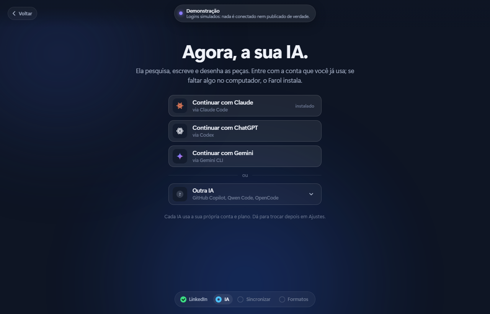
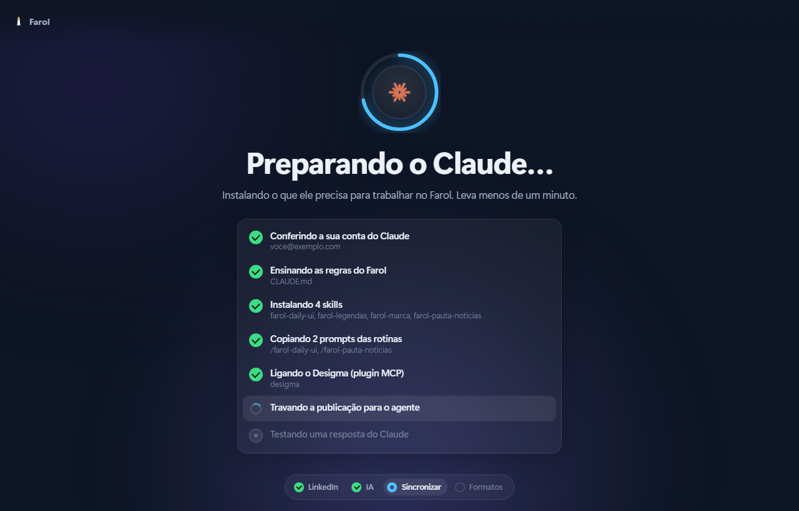
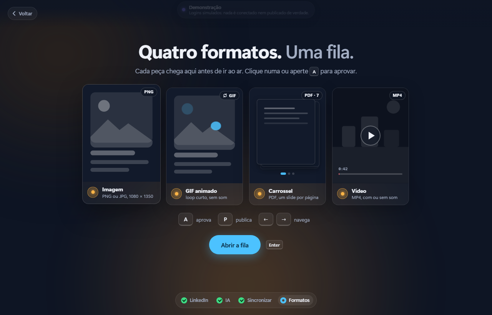
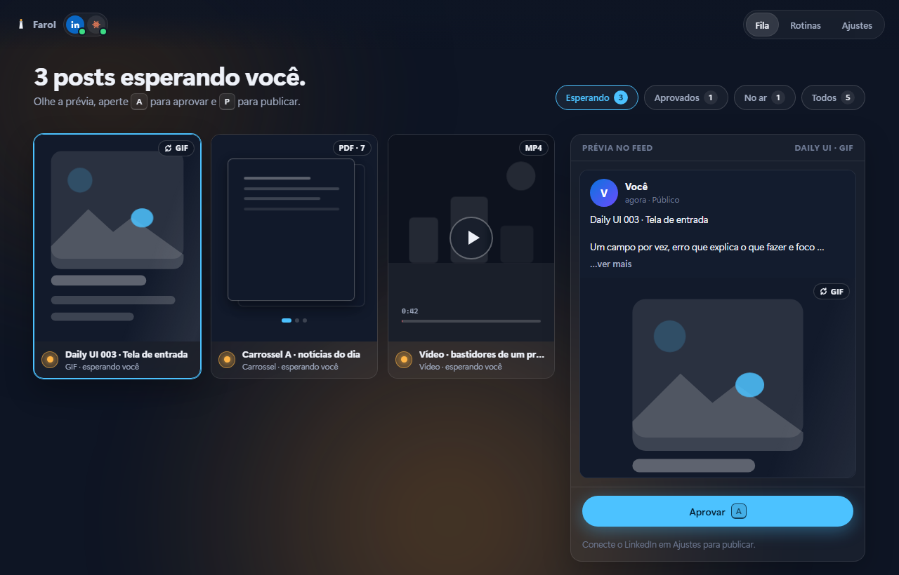

# Farol

**Seus posts no ar, do seu jeito. Nada sai sem você.**

O Farol é um motor de conteúdo para LinkedIn, feito por um designer para designers:
- a **sua IA** (Claude, ChatGPT, Gemini ou outra) pesquisa e desenha as peças no seu design system;
- o **Desigma** monta tudo num projeto editável;
- o **app local do Farol** cuida da parte que é sua: olhar, aprovar e publicar.

**[Ver a demonstração online](https://farol-otavio-guerra.vercel.app)** · **[Baixar para testar](https://github.com/AbapaOnSwamp/farol/releases/latest)**

| LinkedIn | Sua IA | Sincronização | Formatos |
|---|---|---|---|
|  |  |  |  |


Nasceu para o meu próprio perfil ([portfolio-otavio-guerra.vercel.app](https://portfolio-otavio-guerra.vercel.app)), com três frentes:
- uma série de 30 posts sobre o meu trabalho;
- o desafio [Daily UI](https://www.dailyui.co/), feito dentro do universo do meu portfólio;
- dois carrosséis de notícias por dia sobre IA, tecnologia e design.

| Série própria | Daily UI | Carrossel de notícias |
|---|---|---|
|  |  |  |

## O que ele faz
- **Gera peças com o seu design system.** Tudo é desenhado por código (`engine/brand`): cores, fontes, molduras e pixel art seguem as regras do seu site. Nada de template genérico.
- **Pauta com checagem.** A rotina de notícias procura os assuntos do dia, confere em fonte primária ou em dois veículos sérios e mostra "o outro lado" quando o dado é disputado.
- **Daily UI com decisões de UX.** Cada tela vem com as decisões numeradas (foco visível, estados, microcopy, acessibilidade), não só o visual.
- **Projeto editável no Desigma.** Cada peça vira um quadro na página certa do seu `.desigma`, sem perder o que você editou à mão.
- **Todos os formatos de post que a API aceita para pessoas:** só texto, imagem (PNG/JPG), GIF (até 250 quadros), várias imagens (2 a 20), documento/carrossel (PDF, PPT ou DOC, até 100 MB e 300 páginas), vídeo (MP4, de 3 s a 30 min, até 500 MB) e artigo (link com título, descrição e miniatura). Texto alternativo nas imagens e limite de 3.000 caracteres conferido antes de enviar. Carrossel nativo e enquete ficam de fora: o LinkedIn só libera o carrossel em anúncio pago, e a enquete por API não é confirmada para perfis pessoais.
- **Várias contas.** Conecte mais de um perfil e escolha em Ajustes qual publica. O app avisa uma semana antes do acesso vencer (o LinkedIn não renova sozinho para apps comuns).
- **Modelos de post para qualquer profissão.** Notícias da sua área, dicas práticas, mito ou verdade, passo a passo (carrosséis), lição aprendida, bastidores, opinião sobre uma tendência, pergunta para a rede e recomendação (texto). A IA escreve a partir do seu perfil (área, público, tom, pilares). O Daily UI e os carrosséis de IA e design só aparecem para quem é da área de design.
- **Você aprova, ele publica.** A publicação usa a API oficial do LinkedIn. Nenhuma rotina publica sozinha: sem aprovação, nada vai ao ar. Um post aprovado pode ser agendado e sai sozinho no horário.

## O app
Uma ideia por tela, com o mínimo de atrito. A entrada tem cinco passos e nenhum comando fora do app:
1. **LinkedIn:** um botão, "Continuar com LinkedIn", como em qualquer site. Você entra e clica em Permitir; o Farol nunca vê a sua senha.
2. **Você:** uma apresentação logo depois do LinkedIn, uma pergunta por tela, com cartões grandes e barra de progresso: a área (14 opções ou "Outra"), o que você faz (opções da sua área ou o seu cargo escrito), o momento da carreira, o objetivo no LinkedIn e quem você quer alcançar (até 3 de cada), o tom de voz (até 2, cada um com um exemplo de começo de post), a frequência e, se quiser, o seu site. Escolha única avança sozinha; as teclas 1 a 9 escolhem, Enter continua e Esc volta. No fim, um resumo em uma frase mostra como a IA vai te ver, e tocar em qualquer parte dele volta àquela pergunta. O momento da carreira também vira o nível padrão das vagas na aba Rede. O nome e a foto vêm da sua conta do LinkedIn. O LinkedIn não compartilha cargo nem experiência com outros apps, então o resto vem desses toques. Tudo vira o seu perfil, e quando a IA termina de sincronizar ela lê a triagem e o link e sugere o resto na aba Perfil, sem aplicar nada sozinha.
3. **Sua IA:** "Continuar com Claude", "com ChatGPT" (Codex) ou "com Gemini" (Gemini CLI), e um menu com outras (GitHub Copilot, Qwen Code, OpenCode, em beta). Se a ferramenta não estiver instalada, o Farol instala e abre o login no navegador.
4. **Sincronização:** uma tela de carregamento mostra cada passo enquanto o Farol entrega à IA as regras (`agent/AGENTS.md`), as skills (`agent/skills`), os prompts das rotinas, o plugin do Desigma (MCP, se estiver instalado) e a trava que impede a IA de publicar. No fim, um teste rápido confere se ela responde.
5. **Formatos:** os quatro formatos em wireframe (imagem, GIF, carrossel e vídeo) e como aprovar com `A`.

Depois disso, o app tem cinco abas: **Fila**, **Calendário**, **Criar**, **Biblioteca** e **Rede**. **Perfil** e **Ajustes** ficam no menu da sua conta, no canto de cima (Ajustes troca de IA, reconecta o LinkedIn e liga o Desigma). Ao lado de "Fila", um número mostra quantos posts esperam você.

- **Fila:** cada peça ao lado de uma prévia de como ela fica no feed. Aprovar (`A`), publicar agora (`P`) ou **Agendar** para um dia e hora. Agendar um post que ainda não foi aprovado pede a aprovação junto.
- **Calendário:** o mês com o que já foi ao ar, o que está agendado e o que as rotinas vão criar. Clique num dia para ver a lista, mudar o horário, tirar da agenda ou agendar um post ali. Os posts sem data ficam ao lado e podem ser arrastados para um dia. As setas do teclado andam pelos dias.
- **Agenda:** o Farol publica no horário só o que está aprovado, e só enquanto estiver aberto. Se estiver fechado na hora, publica assim que você abrir. Se o post não estiver aprovado quando der a hora, ele sai da agenda e o app avisa.
- **Criar:** atalhos para escrever um post e gerar uma imagem, e os modelos de post. "Criar agora" pede a peça para a sua IA. "Repetir" escolhe os dias da semana e a hora em que ela cria sozinha, enquanto o app estiver aberto. Cada peça chega na Fila esperando você.

- **Biblioteca:** tudo o que pode ir num post, num lugar só. Ficam ali o que você envia (arraste para a tela ou use "Enviar arquivos") e o que as rotinas geram (Daily UI, série, carrosséis). Cada mídia mostra medidas, tamanho e origem e avisa se passar dos limites do LinkedIn. As imagens ganham **texto alternativo**, que vai junto para o post. Excluir manda para a lixeira do workspace e não quebra posts que já usam o arquivo.
- **Editor:** "Novo post" na fila (ou "Usar em novo post" na biblioteca) abre o editor: título, texto com contador de 3.000 caracteres, mídias da biblioteca ou enviadas na hora, ordem com ‹ e ›, texto alternativo por imagem e link com cartão (artigo). O formato sai sozinho das mídias (só texto, imagem, várias imagens, vídeo, documento ou artigo), e as regras do LinkedIn são conferidas enquanto você escreve. A prévia ao lado é o mesmo cartão da fila.
- **Estúdio de imagens (Magnific):** em "Gerar imagem" (Biblioteca), "Gerar com IA" (Editor) ou "Melhorar" e "Refinar" (numa imagem da biblioteca).
  - **Gerar:** cria imagens a partir de um texto com o Mystic, com proporção, resolução, estilo do modelo e de 1 a 4 versões para escolher.
  - **Melhorar:** aumenta 2x, 4x, 8x ou 16x (Upscaler Creative). O Farol mostra o tamanho final e trava o que passaria de 25,3 milhões de pixels.
  - **Refinar:** nitidez, granulação e ultra detalhe (Upscaler Precision).
  - Antes de gastar, o Farol mostra o número de operações e o custo estimado, quando a documentação publica o preço (o do upscale vem pelo tamanho final; o do Mystic não é publicado), e pede confirmação.
  - O resultado é baixado na hora para a biblioteca, porque os links do Magnific vencem em 30 minutos. Vai com o prompt, a imagem de origem e o custo, e de lá segue para o post com um clique.
- **Perfil:** quem publica, para quem, com que objetivo e tom, os temas, o que evitar, os links e o texto "Sobre". Há um perfil por conta do LinkedIn, e o perfil em uso acompanha a conta em uso.
  - **Identidade visual:** 5 cores, com conferência de contraste (AA), fontes, estilo visual e até 3 imagens de referência da biblioteca. Uma prévia ao vivo mostra uma peça com a sua cara.
  - **Análise com a IA:** a sua IA lê o que você preencheu e os seus links, só leitura e pesquisa na web, sem mexer em arquivo nenhum. Ela sugere área, público, tom, temas, pilares de conteúdo e as cores do site. Cada sugestão tem "Aplicar", e nada muda sem você.
  - **Pilares de conteúdo:** os assuntos em que você quer ser lembrado, com ideias de post. Clicar numa ideia abre o editor com ela, e o editor lembra para quem e em que tom escrever.
  - **Como o perfil é usado:** a IA lê `workspace/perfil.md` antes de escrever cada post. O Estúdio usa as cores, o estilo e a primeira referência, e dá para desligar na hora. Com "Usar nas peças das rotinas" ligado, o Daily UI, a série e os carrosséis saem com as suas cores e fontes; desligado, nada muda.
- **Rede:** conexões e vagas para a sua área. A API do LinkedIn não deixa apps verem pessoas, conexões ou vagas, e automatizar isso viola os termos dele. Por isso a sua IA pesquisa na web, só leitura, a partir do seu perfil e das suas preferências (local, modalidade, nível).
  - **Conexões:** sugere tipos de pessoa (nunca nomes inventados), com o motivo, a busca pronta para abrir no próprio LinkedIn e uma mensagem de convite no seu tom.
  - **Para seguir:** comunidades, eventos e hashtags da área.
  - **Vagas:** só vagas públicas recentes cujo link a IA abriu. O Farol confere cada link e descarta os quebrados. Cada vaga mostra modalidade, nível, tipo de contrato e salário (só quando a vaga mostra). Em "Ver detalhes" aparecem os requisitos, os diferenciais e benefícios, o que você já tem, o que pode faltar e como se candidatar.
  - Convites e candidaturas são sempre feitos por você.
- **Conexão com o LinkedIn sem a ponte:** quando a ponte de um clique não está ligada, o Farol abre um passo a passo de 5 passos: Página, app, 2 produtos, endereço de retorno e chaves. Cada passo tem botão para a página certa, "Copiar" e validação, e o Farol lembra onde você parou.
- **Rascunhos:** salvar (`Ctrl S`) guarda um rascunho, que fica na fila em "Rascunhos" até você mandar para aprovação. Sair do editor com algo escrito salva sozinho. Editar um post que já estava aprovado pede a aprovação de novo.

- **Teclado:** `A` aprova, `P` publica, `←` e `→` navegam, `Enter` avança e `Esc` volta na entrada.
- **Brilho de fundo:** muda com o estado. Fica âmbar quando há post esperando você, verde quando tudo está aprovado, roxo enquanto a IA trabalha e vermelho quando algo dá errado.
- **Sons:** tudo em Ré maior. Cada tela tem um pad suave, aprovar e desfazer são dois toques numa quinta (Ré5 e Lá5) e publicar é um arpejo.
- **Movimento reduzido:** quem pede menos movimento no sistema não vê animação.

### Onde cada IA recebe o Farol
| IA | Regras | Skills | Prompts | Plugin (Desigma) | Trava da publicação |
|---|---|---|---|---|---|
| Claude (Claude Code) | `CLAUDE.md` | `.claude/skills` | `.claude/commands` | `.mcp.json` | lista fechada de ferramentas e pastas |
| ChatGPT (Codex) | `AGENTS.md` | `.agents/skills` | `~/.codex/prompts` | `codex mcp add` | sandbox `workspace-write`, terminal sem rede |
| Gemini (Gemini CLI) | `GEMINI.md` | `.gemini/skills` | `.gemini/commands` | `.gemini/settings.json` | `tools.allowed` só com os scripts das rotinas |

Tudo isso é gerado dentro da pasta do Farol a partir de `agent/` e fica fora do Git. Para mudar uma regra ou skill, edite `agent/` e clique em "Sincronizar de novo" em Ajustes. O mapa completo, com as IAs em beta, está em `engine/agentes.js`.

### Imagens com IA (provedores)
- **Chave:** a do Magnific é criada no painel dele e colada em Ajustes → Imagens com IA. O Farol confere a chave com uma leitura que não gasta créditos e guarda no cofre. A chave nunca volta para a tela nem chega à IA.
- **Créditos:** a API do Magnific cobra créditos à parte da assinatura do site. Os planos "ilimitados" valem só no app web do Magnific.
- **Limites:** em Ajustes ficam um limite de operações por mês (cada versão conta uma) e um orçamento em euros, somado pelas estimativas. A API não informa o saldo, então o Farol mantém o próprio livro em `workspace/imagens/custos.json`.
- **Tarefas:** cada pedido vira uma tarefa no provedor. O Farol consulta até ficar pronta (`workspace/imagens/tarefas.json`) e retoma as que estavam em andamento se o app for reaberto.
- **Outros provedores:** um provedor novo é um arquivo em `engine/imagem/provedores/` com a mesma interface (`validar`, `estimar`, `iniciar`, `consultar`). O resto do Farol não muda.

### Login do LinkedIn em um clique (ponte do Farol)
O LinkedIn exige um app com Client Secret, que não pode ir dentro de um programa baixado. Por isso o botão passa por uma ponte pequena na Vercel (`api/linkedin`): ela guarda o segredo, troca o código pelo token e devolve o token direto para o seu Farol em `127.0.0.1`, num fragmento de URL que não passa por servidor nenhum. O Farol confere o token com o próprio LinkedIn antes de salvar.

Para ligar a ponte (uma vez, por quem publica o Farol), com as chaves do seu app já salvas no Farol e a Vercel CLI logada:
```bash
npm run ponte:ativar
```
O script manda as chaves do cofre direto para a Vercel (sem mostrar na tela), publica e confere se a ponte respondeu. Depois, no app do LinkedIn (**Auth → Authorized redirect URLs**), adicione `https://farol-otavio-guerra.vercel.app/api/linkedin/callback`.

Enquanto a ponte não estiver ligada, o botão avisa e oferece "Usar meu próprio app do LinkedIn", o jeito antigo, com as suas chaves.



## Começar
Precisa de:
- **Node 20+** (só para rodar pelo terminal; o `Farol.exe` já traz o Node dentro);
- uma conta de IA (Claude, ChatGPT ou Gemini); a ferramenta de linha de comando o Farol instala na entrada;
- **Microsoft Edge** (para exportar PNG e PDF);
- **[Desigma](https://github.com/deepfounder-ai/desigma/releases)**, se quiser o projeto editável.

As fontes do design system de exemplo (Space Grotesk, IBM Plex Sans, Press Start 2P, VT323 e DM Serif Display, todas do Google Fonts) precisam estar instaladas para as exportações saírem iguais.

**Jeito fácil (Windows):**
1. Baixe o `Farol-windows.zip` na [página de releases](https://github.com/AbapaOnSwamp/farol/releases/latest).
2. Extraia a pasta inteira e dê dois cliques em `Farol.exe`.
3. O app abre na janela dele, sem barra de navegador. Fechar a janela encerra o Farol.

O Windows pode mostrar o aviso "O Windows protegeu o computador", porque o exe ainda não tem assinatura digital. Clique em **Mais informações → Executar assim mesmo**.

Para gerar o exe você mesmo: `npm run exe` (precisa do Node 25.5+; o ícone sai se a variável `RCEDIT` apontar para o `rcedit-x64.exe`).

**Pelo terminal:**
```bash
git clone https://github.com/AbapaOnSwamp/farol
cd farol
npm start
```
Depois é seguir a entrada. Para mudar caminhos à mão, copie `config/engine.config.example.json` para `config/engine.config.json`.

### Versão desktop (Tauri 2, instalador .exe)
O app desktop é uma janela nativa do Windows (WebView2) em volta do mesmo painel. Não há uma segunda interface: o que funciona no `npm start` funciona no app.

- **Desenvolver:** `npm run desktop:dev` abre a janela nativa apontando para o servidor local (`npm start`, em `127.0.0.1:4800`). Também dá para continuar só no navegador, como sempre.
- **Gerar o instalador:** `npm run desktop:build` cria `src-tauri/target/release/bundle/nsis/Farol_<versão>_x64-setup.exe` (cerca de 30 MB). A instalação é por usuário, em `%LOCALAPPDATA%Farol`, sem pedir administrador, e baixa o WebView2 se faltar. Para instalar sem perguntas: `Farol_<versão>_x64-setup.exe /S`.
- **Precisa, só para compilar:** Rust (rustup), Visual Studio Build Tools com C++ e Node 22.13 ou mais novo. Quem instala o Farol não precisa de nada disso.

Como o app funciona por dentro:
1. O Tauri abre a tela "Abrindo o Farol…" e inicia o Node que vem dentro do app (`farol-node`, copiado do seu Node por `app/desktop/preparar.js`).
2. Esse Node roda `app/desktop/backend.js`, que copia o motor para a pasta de trabalho `DocumentosFarol`. Ali ficam também a configuração, o cofre e os posts. Uma atualização troca o motor, mas nunca apaga o seu conteúdo nem o que a IA escreveu em `dias/` e `pautas/`.
3. O painel sobe em `127.0.0.1:4800` (ou outra porta livre, se a 4800 estiver ocupada) e a janela vai para lá.
4. As rotinas encontram um `node` mesmo sem Node instalado no computador, e a caixa de permissões continua valendo.
5. Links abrem no navegador padrão e arquivos no programa padrão. Abrir o app de novo traz a janela que já existe. Fechar a janela encerra o backend.

O `Farol.exe` portátil (`npm run exe`) continua existindo, para quem prefere não instalar.

## Segurança
- O app escuta só em `127.0.0.1` e toda ação exige um token novo a cada vez que ele sobe. Assim, um site aberto no navegador não consegue agir por você.
- O painel só responde a quem chama pelo endereço local exato (`127.0.0.1:<porta>` ou `localhost:<porta>`). Isso barra o "DNS rebinding", em que um site aponta o próprio domínio para o seu computador para ler o painel.
- **Nada de moldura de outro site:** o painel manda `X-Frame-Options: DENY` e uma CSP (`frame-ancestors 'none'`). Assim, nenhum site consegue carregar o Farol escondido num quadro para fazer você clicar em "Publicar". A CSP também só deixa rodar os arquivos do próprio Farol e conversar com ele mesmo: se um texto vindo da IA ou da web tentar virar código, ele não roda nem manda dados para fora.
- **Arquivos do workspace** (`/files/`) só abrem para o próprio painel (`Cross-Origin-Resource-Policy` e `Sec-Fetch-Site`), nunca dentro de outro site, e nunca fora da pasta `workspace`.
- **Links que vêm da IA:** o painel só aceita `http` e `https`. Na aba Rede, antes de conferir o link de uma vaga, o Farol recusa endereços da rede de casa, do roteador ou deste computador, inclusive quando um site redireciona para eles.
- **Cofre de segredos** (`engine/segredos.js`): o token e as chaves do LinkedIn ficam em `config/segredos.dat`, cifrado com a DPAPI do Windows, que só o seu usuário, neste computador, consegue abrir. Os arquivos antigos em texto puro são migrados e apagados sozinhos na primeira vez. O app nunca devolve segredos para a tela.
- No login de um clique, o token volta da ponte só para `127.0.0.1`, com um código de verificação (`state`) que expira em 10 minutos; o Farol confere o token com o LinkedIn antes de salvar.
- **A IA não publica e não abre o cofre.** Nas rotinas, ela só pode ler, pesquisar, usar o Desigma, escrever em `engine/dailyui/dias` e `engine/noticias/pautas` e rodar os scripts das rotinas (`SCRIPTS` em `engine/agentes.js`). Ler `config/`, rodar `node -e`, PowerShell ou o script de publicação fica bloqueado.
- **Caixa de permissões** (`engine/caixa.js`): o código que a IA escreve (um dia do Daily UI, uma pauta) roda dentro do modelo de permissões do Node, sem abrir processos, sem rede e lendo só o motor, as imagens e a configuração. Se uma página da web induzir a IA a escrever algo malicioso, esse código não consegue rodar programas, abrir o cofre nem publicar. Precisa do Node 22.13 ou mais novo (no Node 25+ a rede também fica bloqueada).
- O Claude tem o isolamento mais forte (a lista fechada impede editar o resto do motor). As outras IAs podem editar qualquer arquivo do projeto; para elas a caixa protege o código das rotinas, mas uma IA mal-intencionada poderia desligá-la editando o motor.
- O token do LinkedIn vence em 60 dias e não renova sozinho (a renovação automática é só para parceiros aprovados pelo LinkedIn). O app avisa uma semana antes, e reconectar leva um clique.
- Sem a permissão restrita `r_member_social`, a API não deixa ler os próprios posts. Por isso o histórico fica em `workspace/publicados.json`: data, formato, arquivos, identificador e link de cada post, e quem publicou.

## Estrutura
```
app/            o app local (server.js sem dependências + public/)
  desktop/      versão desktop: backend.js (o que o app roda), preparar.js (build) e janela/ (tela de espera)
src-tauri/      projeto Tauri 2: janela nativa, Node embutido (sidecar), ícones e instalador NSIS
engine/
  brand/        tokens e peças do design system (lib.js, kit.js)
  series/       série de posts próprios
  dailyui/      telas do Daily UI (dias/NNN.js) e a lista dos 100 temas
  noticias/     carrosséis: pautas, gerador e exportação em PDF
  desigma/      juntar páginas e anexar quadros no .desigma
  linkedin/     OAuth e publicação pela API oficial (imagem, GIF, PDF, vídeo)
  agentes.js    instalar, entrar e sincronizar cada IA
  segredos.js   cofre cifrado (DPAPI) para tokens e chaves
  midia.js      biblioteca de mídia (envio, medidas, limites, texto alternativo, origem)
  posts.js      posts do editor (rascunhos em workspace/avulsos/<id>/)
  imagem/       geração e melhoria de imagens: index.js (tarefas, custos, limites) e provedores/ (magnific.js)
  perfis.js     perfis (quem publica, público, tom, pilares, marca), resumo para a IA e análise com a IA
  caixa.js      caixa de permissões para o código escrito pela IA
agent/          regras e skills que o Farol entrega à sua IA (fonte única)
api/linkedin/   ponte do login de um clique (Vercel)
prompts/        instruções das rotinas (viram comandos /farol-* na IA)
examples/assets imagens de exemplo (pixel art do meu portfólio)
workspace/      tudo o que é gerado (fora do Git). midia/ é a biblioteca (index.json guarda texto alternativo e origem);
                lixeira/ recebe o que você exclui; perfis/ guarda os perfis e perfil.md é o resumo que a IA lê.
                Em avulsos/, cada post é:
                  nome.png|gif|jpg|mp4|pdf + nome.txt      um arquivo com legenda
                  nome.txt                                 só texto
                  pasta/ imagens + legenda.txt             várias imagens (2 a 20; <imagem>.alt.txt = texto alternativo)
                  pasta/ link.json + legenda.txt           artigo ({"url", "titulo", "descricao"}; miniatura.png opcional)
                  pasta/ do editor                         01-, 02-... na ordem, post.json (título, rascunho), um vídeo ou documento, ou só texto
config/         configuração local e o cofre segredos.dat (fora do Git)

FAROL_DATA      variável opcional: muda a pasta de config/ e workspace/
FAROL_HOME      na versão desktop: a pasta de trabalho do usuário (DocumentosFarol)
```

## Agendar
Na aba Criar, "Repetir" faz a sua IA criar um modelo nos dias e na hora que você escolher, enquanto o app estiver aberto (a agenda fica em `config`, em `rotinas`). Os modelos estão em `engine/modelos.js`, e as instruções de cada um são escritas a partir do seu perfil em `workspace/rotinas/<modelo>.md` na hora de rodar. Para rodar com o app fechado, aponte uma tarefa agendada da sua IA para esses arquivos. Os posts agendados ficam em `workspace/agenda.json`. A publicação continua passando pela sua aprovação.

## Créditos
- A linguagem da interface (uma ideia por tela, brilho de estado, keycaps, pílula de aviso) foi inspirada no onboarding do **[Mutto](https://mutto.app)**, um app brasileiro para mutar o microfone. O código e os sons do Farol foram feitos do zero.
- Construído por mim com o **[Claude Code](https://claude.com/claude-code)** como par de programação: eu defini o design system, o fluxo e as regras (o que pode e o que não pode ir ao ar sozinho), e o Claude escreveu boa parte do código comigo.

## Licença
Código sob licença MIT. As imagens de `examples/assets` e os textos da série são meus e estão aqui só como exemplo.
